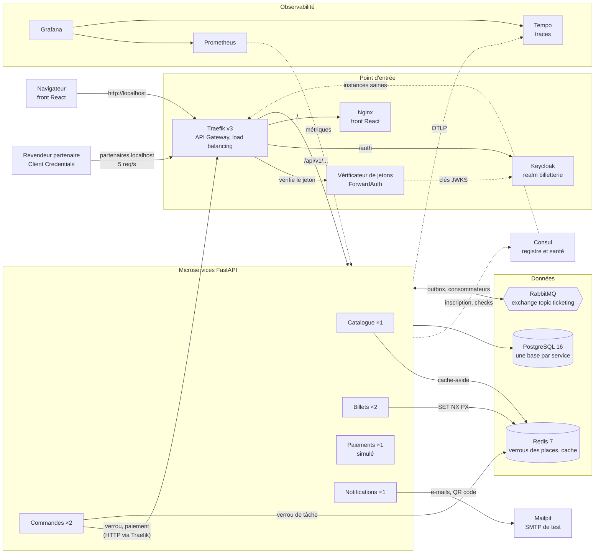

# billetterie

Plateforme de vente de billets pour concerts et spectacles : microservices Python 3.12 / FastAPI,
PostgreSQL, Redis, RabbitMQ, Consul, Traefik et Keycloak, front React dans `frontend/`.

Projet personnel, conçu et développé seul pour pratiquer une architecture en microservices sur
un problème réel : vendre un stock limité de places à des milliers de clients qui cliquent en
même temps, sans jamais vendre une place deux fois.

> **Vidéo de démonstration (3 minutes)** : _lien à compléter_
> (achat d'un billet, panne d'une instance de Billets, panne de Notifications).

## Le défi : aucune place vendue deux fois

À l'ouverture des ventes, des milliers de clients visent les mêmes places au même instant. Deux
lignes de défense, indépendantes, empêchent la double vente :

1. **Verrou Redis atomique.** Quand Commandes réserve une place, Billets exécute un script Lua
   qui pose `SET place:<seance_id>:<place_id> <commande_id> NX PX <durée>` : le premier arrivé
   obtient le verrou (10 minutes), tous les autres reçoivent aussitôt `409 SEAT_ALREADY_TAKEN`.
   Juste avant de payer, Commandes prolonge ses verrous à 1 heure ; une place perdue entre-temps
   expire la commande, sans aucun débit. Le verrou ne se lève que par son détenteur
   (comparer puis supprimer, en Lua). Redis injoignable : `503 VERROU_INDISPONIBLE`, jamais un
   200 sans verrou (échec fermé).
2. **Contrainte unique en base.** Le billet est émis dans PostgreSQL sous la contrainte
   `uq_billets_place` (une seule ligne par place) et une clé étrangère composite
   (séance, place). Si le verrou a disparu (expiration, panne Redis), la base refuse quand même
   le second billet : l'émission de la commande est annulée en entier, Billets publie
   `ticketing.ticket.rejected` et le client est remboursé automatiquement.

Autour de ces deux verrous :

- **plafond de billets par client et par séance**, compté sous `pg_advisory_xact_lock` ;
- **idempotence** : `Idempotency-Key` sur la création de commande et le paiement, un seul
  paiement par commande (`UNIQUE (commande_id)`), transitions de statut gardées
  (`WHERE statut = 'EN_ATTENTE'`) ;
- **outbox transactionnelle** : un événement n'est publié que si la transaction métier est
  validée, et chaque consommateur ignore un message déjà traité ;
- **aucun état en mémoire** : Billets et Commandes tournent en deux instances derrière Traefik.

**Comment c'est prouvé** : `make test-concurrence` (BIL-007) lance 100 verrouillages
simultanés de la même place contre un vrai PostgreSQL et un vrai Redis (Testcontainers, aucun
simulacre) et exige exactement un succès et 99 refus, dix exécutions de suite. Un second test
contourne Redis : la contrainte en base empêche seule la double vente. D'autres tests disputent
une même place entre deux clients et une même commande entre deux paiements (BIL-008). Ces
tests tournent dans la CI (job `integration`).

## Architecture



| Service | Rôle | Instances |
|---|---|---|
| Catalogue | Événements, lieux, séances, catégories ; cache Redis des lectures | 1 |
| Billets | Places, verrou Redis, émission des billets avec QR code signé (HMAC) | 2 |
| Commandes | Commande, plafond par client, expiration des commandes non payées | 2 |
| Paiements | Paiement simulé (carte de test), remboursement | 1 |
| Notifications | E-mails : billet, annulation, remboursement | 1 |

Les comptes utilisateurs sont gérés par Keycloak. Chaque service a sa propre base (aucune table
partagée, aucune jointure entre services) et communique par HTTP synchrone (client résilient :
délai, nouvelles tentatives, disjoncteur) ou par événements `ticketing.*` sur RabbitMQ.

Parcours d'achat : Commandes crée la commande `EN_ATTENTE` et verrouille chaque place chez
Billets ; au paiement, elle prolonge les verrous puis appelle Paiements ; paiement accepté, elle
publie `ticketing.order.confirmed` ; Billets émet les billets (`ticketing.ticket.issued`) et
Notifications envoie l'e-mail. Une commande non payée à l'échéance expire et libère ses places.
Détail : [conception](docs/conception.md), [modèle de données](docs/modele-donnees.md).

| Besoin | Choix |
|---|---|
| Services | Python 3.12, FastAPI, Pydantic v2, SQLAlchemy 2, Alembic, workspace uv |
| Données | PostgreSQL 16 (une base par service), Redis 7 |
| Messages | RabbitMQ, exchange topic `ticketing`, FastStream, outbox |
| Infrastructure | Consul, Traefik v3, Keycloak, Docker Compose |
| Observabilité | OpenTelemetry, Prometheus, Tempo, Grafana |
| Front | React, Vite, TypeScript strict, TanStack Query, oidc-client-ts |
| Qualité | pytest, Testcontainers, Vitest, ruff, mypy strict, GitHub Actions |

Pourquoi cette pile plutôt que Spring Cloud : [ADR-001](docs/adr/001-pile-technique.md).

## Documentation

- [Conception](docs/conception.md) : vision, microservices, règles métier, flux critique, pannes,
  API partenaires
- [Conventions](docs/conventions.md) : contrats, routes, erreurs, données, événements
- [ADR-001 : pile technique](docs/adr/001-pile-technique.md) : pourquoi FastAPI, Consul,
  Traefik, Keycloak et RabbitMQ
- [ADR-002 : traces avec Tempo](docs/adr/002-traces-tempo.md)
- [Spécification](docs/specification.md) : fonctionnalités prévues, réalisées et reportées
- [Modèle de données](docs/modele-donnees.md), contrats OpenAPI dans `docs/contrats/`, schémas
  des événements dans `docs/evenements/`
- [Démo et pannes des services](docs/demo.md), [pannes de l'infrastructure](docs/pannes-infra.md)
- Front : [parcours](docs/front/parcours.md), [écrans](docs/front/ecrans.md),
  [routes](docs/front/routes.md)
- [Workflow de développement](docs/workflow.md) et décisions de chaque ticket dans
  `docs/tickets/`

## Lancer le projet sur une machine vierge

### 1. Prérequis

| Outil | Rôle |
|---|---|
| Git | cloner le dépôt ; sous Windows, Git for Windows fournit aussi Git Bash |
| Docker avec Compose v2 (Docker Desktop sous Windows et macOS) | toute la plateforme |
| GNU Make | raccourcis `make ...` (sous Windows : `winget install GnuWin32.Make`, par exemple) |
| [uv](https://docs.astral.sh/uv/) | environnement Python, tests, scripts de démo |
| bash | scripts de démo et de panne (`make pannes`, `make demo-pannes`) ; Git Bash sous Windows |

Node.js n'est pas nécessaire pour lancer la plateforme (le front est construit dans Docker) ;
il ne sert qu'à développer le front (`frontend/`). Prévoir quelques gigaoctets de mémoire
libres pour Docker et les ports locaux suivants libres : 80, 8080, 1025, 3000, 5432, 5672,
6379, 8025, 8500, 9090 et 15672.

### 2. Cloner et créer le `.env`

```sh
git clone https://github.com/AGNE-Moussa/billetterie.git billetterie
cd billetterie
```

`.env.example` liste toutes les variables, avec des valeurs vides. Copiez-le en `.env`
(`cp .env.example .env`, ou `Copy-Item .env.example .env` sous PowerShell) puis renseignez au
moins les variables obligatoires : `make up` s'arrête et nomme la variable qui manque.

| Variable obligatoire | Valeur |
|---|---|
| `POSTGRES_USER`, `POSTGRES_PASSWORD` | super-utilisateur PostgreSQL (initialisation des bases) |
| `ECHO_DB_PASSWORD`, `CATALOGUE_DB_PASSWORD` | mot de passe de chaque base de service |
| `BILLETS_DB_PASSWORD`, `COMMANDES_DB_PASSWORD` | idem |
| `PAIEMENTS_DB_PASSWORD`, `NOTIFICATIONS_DB_PASSWORD` | idem |
| `KEYCLOAK_DB_PASSWORD` | base de Keycloak |
| `QR_CLE_SIGNATURE` | clé HMAC des QR codes, au moins 32 caractères |
| `RABBITMQ_DEFAULT_USER`, `RABBITMQ_DEFAULT_PASS` | compte RabbitMQ |
| `KEYCLOAK_ADMIN`, `KEYCLOAK_ADMIN_PASSWORD` | console d'administration Keycloak |
| `KEYCLOAK_REALM` | `billetterie` (déjà rempli) |
| `KEYCLOAK_SERVICES_SECRET` | secret du client `services` (appels entre services) |
| `KEYCLOAK_REVENDEUR_SECRET` | secret du revendeur de test `revendeur-test` |
| `KEYCLOAK_MDP_CLIENT`, `KEYCLOAK_MDP_ADMIN` | mots de passe de `client.test` et `admin.test` |
| `CORS_ORIGINS` | `http://localhost` |
| `GRAFANA_ADMIN_PASSWORD` | compte admin de Grafana (exigé par `compose.yaml`) |

Facultatives, vides acceptées : `KEYCLOAK_URL_FRONT`, `ROUTES_PUBLIQUES` et `HOTE_PARTENAIRES`
(valeurs par défaut dans `compose.yaml`) ; `DATABASE_URL`, `REDIS_URL`, `RABBITMQ_URL` et
`CONSUL_URL` ne servent qu'aux outils lancés depuis le poste, pas à `make up`.

Pour les secrets, n'utilisez que des lettres, des chiffres, `-` et `_` : plusieurs d'entre eux
entrent dans des URL de connexion (`postgresql+asyncpg://...`, `amqp://...`). Une valeur
aléatoire convenable, après `uv sync` :

```sh
uv run python -c "import secrets; print(secrets.token_urlsafe(32))"
```

Les bases sont créées et le realm Keycloak importé au **premier** démarrage seulement : si vous
changez ensuite un mot de passe du `.env`, lancez `make reset` (efface les volumes) puis
`make up`.

### 3. Démarrer

Prérequis : [uv](https://docs.astral.sh/uv/), Docker, GNU Make.

```sh
uv sync          # installe Python 3.12 si besoin et l'environnement de développement
cp .env.example .env
make init        # active les hooks Git (refus des messages hors Conventional Commits)
make help        # liste les commandes disponibles
make up          # démarre la plateforme locale
make observabilite  # idem, avec Prometheus et Grafana (tableau de bord de la démo)
```

`cp .env.example .env` est l'étape 2 ci-dessus : ne la rejouez pas sur un `.env` déjà rempli.
Le premier `make up` construit les images et attend que tous les conteneurs soient sains :
comptez plusieurs minutes (Keycloak est le plus long). Chargez ensuite le jeu de démonstration
du catalogue (lieux, événements et séances, dont la « Soirée jazz » de la démo) :

```sh
make demo
```

Arrêt : `make down` ; tout effacer (volumes compris) : `make reset`.

### 4. Vérifier

Ouvrez http://localhost : le catalogue s'affiche. Connectez-vous avec `client.test`, choisissez
des places, payez avec la carte de test proposée, puis retrouvez l'e-mail et le QR code dans
Mailpit (http://127.0.0.1:8025). Le parcours complet, joué par Newman : `make parcours`.

## Accès locaux

Après `make up`, tout est publié sur la machine locale uniquement. La gateway sert un seul
domaine, `http://localhost`, pour l'API, l'authentification et le front :

| Composant | Adresse |
|---|---|
| Front React (Nginx) | http://localhost/ |
| API Gateway (point d'entrée de l'API) | http://localhost/api/v1/... |
| Keycloak, realm `billetterie` | http://localhost/auth/realms/billetterie |
| Console d'administration Keycloak | http://localhost/auth/admin (`KEYCLOAK_ADMIN` du `.env`) |
| Tableau de bord Traefik | http://127.0.0.1:8080/dashboard/ |
| Consul (registre de services) | http://127.0.0.1:8500 |
| RabbitMQ (interface de gestion) | http://127.0.0.1:15672 |
| Mailpit (boîte de réception de test) | http://127.0.0.1:8025 |
| Grafana : tableau de bord et traces (`make observabilite`) | http://127.0.0.1:3000 (1) |
| Prometheus (`make observabilite`) | http://127.0.0.1:9090 |
| PostgreSQL / Redis | `127.0.0.1:5432` / `127.0.0.1:6379` |

(1) Lecture sans compte ; admin : `GRAFANA_ADMIN_PASSWORD` du `.env`.

L'API exige un jeton Keycloak (`Authorization: Bearer ...`) : sans jeton valide, la gateway
répond 401 sans appeler le service. Les routes ouvertes sans jeton se déclarent dans
`ROUTES_PUBLIQUES` (voir `infra/verificateur/README.md`).

## Comptes de test

Tous les mots de passe et secrets sont dans votre `.env`, jamais dans le dépôt.

| Compte | Rôle | Connexion | Secret (`.env`) |
|---|---|---|---|
| `client.test` | `customer` (acheteur) | front, Authorization Code + PKCE | `KEYCLOAK_MDP_CLIENT` |
| `admin.test` | `admin` (organisateur) | front, espace `/organisateur` | `KEYCLOAK_MDP_ADMIN` |
| `revendeur-test` | `partner` (revendeur) | API, Client Credentials | `KEYCLOAK_REVENDEUR_SECRET` |
| `services` | scopes de service | appels entre services | `KEYCLOAK_SERVICES_SECRET` |
| `KEYCLOAK_ADMIN` | administrateur Keycloak | console `/auth/admin` | `KEYCLOAK_ADMIN_PASSWORD` |

Le revendeur appelle l'API sur l'hôte des partenaires, http://partenaires.localhost
(`HOTE_PARTENAIRES`, mêmes chemins `/api/v1/...`, quota de 5 requêtes par seconde par jeton,
429 au-delà) ; son jeton est refusé sur http://localhost (403 `ROLE_MANQUANT`). Il ne voit que
ses propres commandes et billets. Documentation : `docs/contrats/partenaires.yaml`.

## Scénarios de panne

La conception prévoit la réponse de la plateforme à chaque panne ; les scripts la provoquent
pendant le trafic et comparent la réponse prévue à la réponse observée (`OK` ou `ÉCART`).

```sh
make demo-pannes   # parcours complet, puis les quatre pannes des services (environ 10 minutes)
make pannes        # pannes de l'infrastructure : instance echo, RabbitMQ, Consul
```

Prérequis : `make up` (ou `make observabilite` pour suivre la panne dans Grafana) et `make demo`.
Un scénario seul : `bash scripts/demo.sh notifications|catalogue|billets|paiements`.

| Panne | Réponse prévue |
|---|---|
| Notifications arrêté | Achat confirmé ; e-mails gardés dans RabbitMQ, envoyés au redémarrage |
| Catalogue arrêté | Lecture depuis le cache, sinon 503 ; achat refusé en 503 |
| Une instance de Billets tuée | L'autre instance prend le relais : aucune erreur visible |
| Paiements arrêté | 503 avec invitation à réessayer ; commande en attente, place gardée |
| Instance echo, RabbitMQ, Consul | Aucune erreur client (mesuré : 0 erreur sur 301 appels) |

Déroulé minuté de la démo (moins de 15 minutes), détail de chaque contrôle et écarts connus :
[docs/demo.md](docs/demo.md). Pannes de l'infrastructure, avec les correctifs qu'elles ont
provoqués : [docs/pannes-infra.md](docs/pannes-infra.md).

## Commandes

```sh
uv sync                    # installer l'environnement
make init                  # activer le hook commit-msg (.githooks/)
make up / make down        # démarrer (attend healthy) / arrêter la plateforme locale
make observabilite         # démarrer avec Prometheus et Grafana (profil Compose observabilite)
make pannes                # rejouer les scénarios de panne (docs/pannes-infra.md)
make reset                 # tout arrêter et effacer les volumes (rejoue l'init des bases)
make demo                  # charger le jeu de démonstration du catalogue (plateforme démarrée)
make test                  # tous les tests (uv run pytest)
make test-unit             # tests unitaires (tests/unit et services/*/tests/unit), sans Docker
make test-integration      # tests d'intégration (Testcontainers, Docker requis), hors concurrence
make test-concurrence      # même place disputée en parallèle, vraie base et vrai Redis (BIL-007)
make test-smoke            # smoke tests contre la plateforme démarrée (skill /smoke-tests)
make lint                  # ruff check + ruff format --check
make typecheck             # mypy strict
make parcours              # parcours complet postman/billetterie.json joué par Newman
make demo-pannes           # parcours puis pannes des services de la conception (docs/demo.md)
```

## Structure

```text
.claude/             outillage Claude (rules, agents, skills, hooks)
.github/workflows/   CI, déploiement
docs/                conception, ADR, contrats, plans de test, reviews, tickets
infra/               postgres, traefik, consul, keycloak, rabbitmq, prometheus, tempo, grafana,
                     verificateur
libs/commun/         code partagé entre les services
services/            microservices FastAPI
frontend/            application React
tests/smoke/         smoke tests de la plateforme
postman/             collections et scénarios de panne
```

## Méthode de travail

Chaque fonctionnalité part d'un ticket (`BIL-...`) et suit le même chemin : contrat OpenAPI,
plan de tests, tests écrits rouges, implémentation, relecture, pull request. Une partie du code
est produite par des agents Claude Code spécialisés (`.claude/agents/`) et relue par moi ; le
pipeline est décrit dans [docs/workflow.md](docs/workflow.md) et chaque décision prise en route
est consignée dans `docs/tickets/<ID>.md`. Ce qui est fait, reporté ou reste à vérifier :
[docs/specification.md](docs/specification.md).

## Règles de contribution

Aucun push direct sur `main` : une branche par ticket, une pull request, CI verte avant fusion.

## Licence

[MIT](LICENSE).
