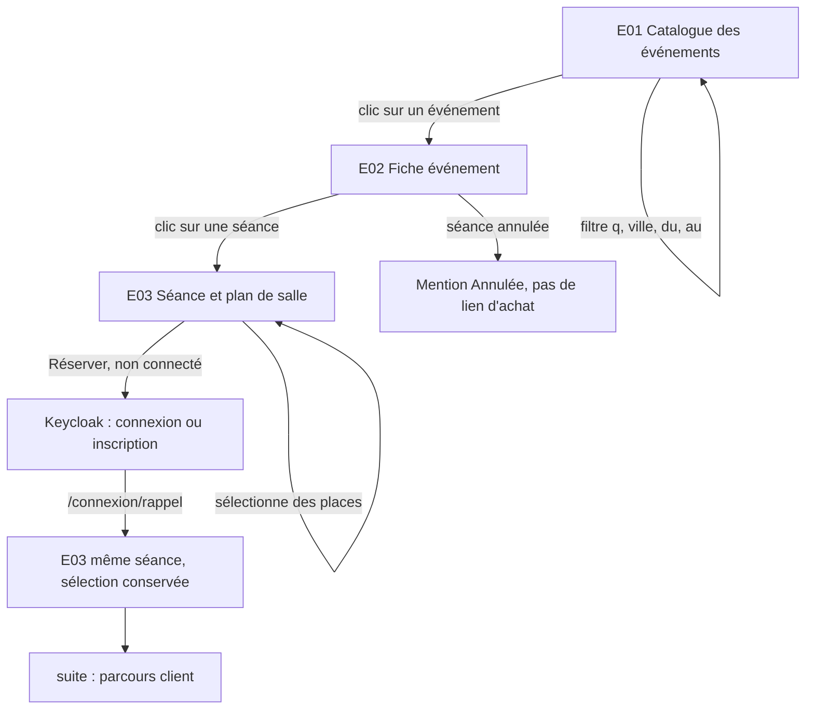
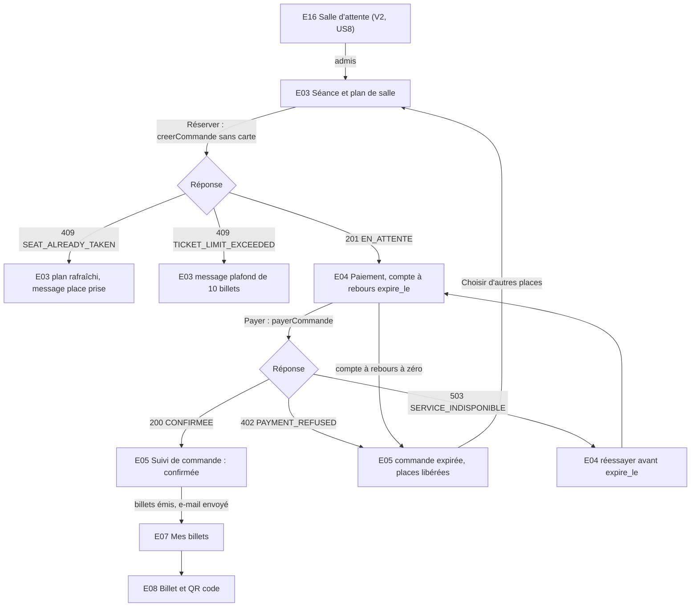
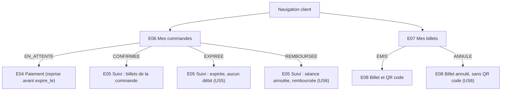
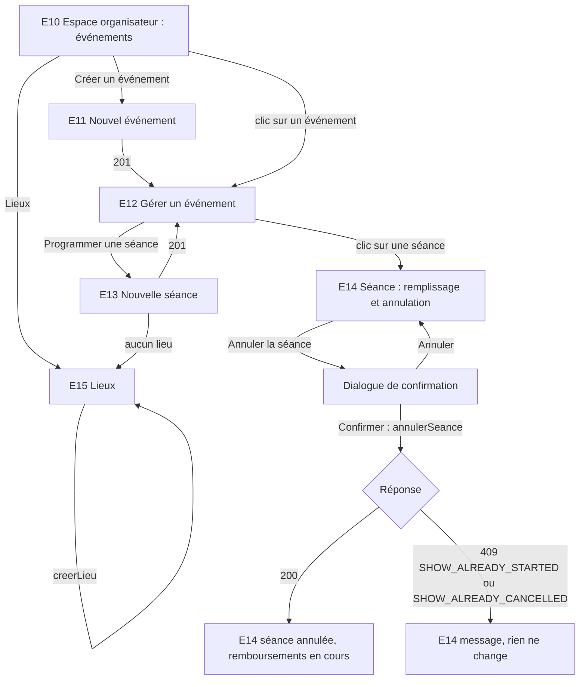

# Parcours du front billetterie

Parcours par profil (BIL-018). Les écrans `E01` à `E16` sont décrits dans `ecrans.md`, leurs
routes React dans `routes.md`. Les décisions encore ouvertes (Q1 à Q8) sont listées à la fin de
`ecrans.md` ; les parcours ci-dessous suivent leur recommandation.

## Profils

| Profil | Rôle Keycloak | Connexion | User stories |
| --- | --- | --- | --- |
| Visiteur | aucun | non connecté | US1 |
| Client | `customer` | Authorization Code + PKCE (`frontend`) | US2, US3, US4, US5, US6, US8 |
| Organisateur | `admin` | Authorization Code + PKCE (`frontend`) | US6 |
| Revendeur | `partner` | Client Credentials (`revendeur-test`) | US7 |

**US7 (revendeur) n'a aucun écran** : le revendeur est une application qui appelle l'API avec
son propre client Keycloak (Client Credentials), sans utilisateur humain ni navigateur. Sa
documentation est `docs/contrats/partenaires.yaml`. Le front ne propose donc aucune route au rôle
`partner` ; un compte `partner` connecté par erreur au front voit les pages publiques et
« Accès refusé » ailleurs.

Les rôles sont sans hiérarchie : le compte `admin.test` ne porte que `admin` et ne peut pas
acheter (`orders:write` est réservé à `customer` et `partner`).

## Visiteur (US1)

Le visiteur parcourt le catalogue sans compte. Il voit le plan de salle d'une séance ; choisir
des places le fait passer par la connexion, puis il revient sur la même séance avec sa sélection
(gardée dans l'URL).

## Client (US2 à US6, US8)

Parcours d'achat, en deux temps comme dans la conception : réservation (verrou de 10 minutes
avec compte à rebours), puis paiement. Il suppose la recommandation de Q1 (réserver sans payer) ;
la variante sans changement du back est décrite dans `ecrans.md` (E03 et E04).

Suivi après achat, depuis la navigation (« Mes commandes », « Mes billets ») :

US5 vue du client : une place abandonnée par un autre redevient libre sur E03 (le plan est
relu), et sa propre commande non payée passe en `EXPIREE` sur E05 et E06.

US6 vue du client : la séance porte « Annulée » sur E02 et E03, la commande passe en
`REMBOURSEE` (E05, E06), le billet en `ANNULE` (E07, E08) ; l'e-mail part côté back.

## Organisateur (US6)

L'organisateur (`admin`) prépare son catalogue, suit le remplissage d'une séance et l'annule.

## Couverture des user stories

| US | Parcours | Écrans |
| --- | --- | --- |
| US1 | Visiteur | E01, E02, E03 |
| US2 | Client | E03, E04 |
| US3 | Client | E04, E05 |
| US4 | Client | E05, E07, E08 |
| US5 | Client | E03, E04, E05, E06 |
| US6 | Organisateur (annuler), client (subir) | E10 à E15 ; E05 à E08 côté client |
| US7 | Aucun (API seule) | aucun |
| US8 | Client (V2) | E16 |
