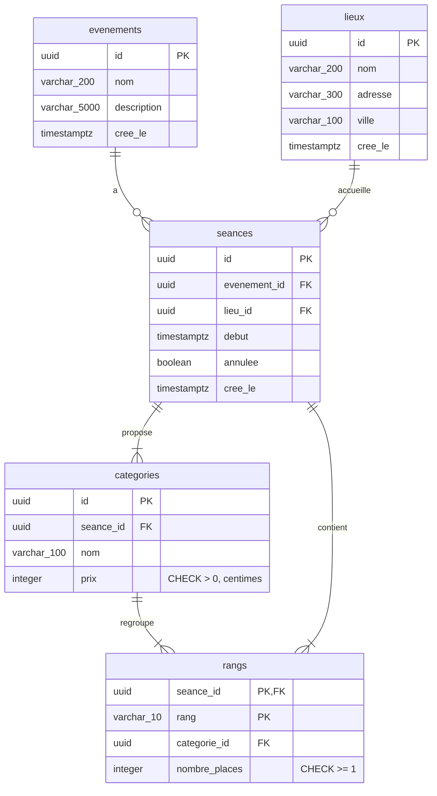
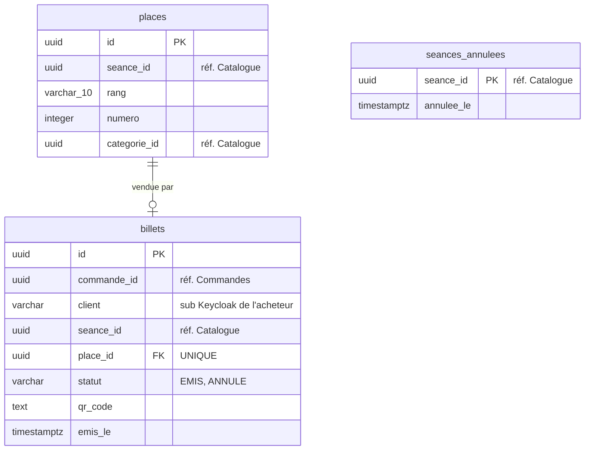
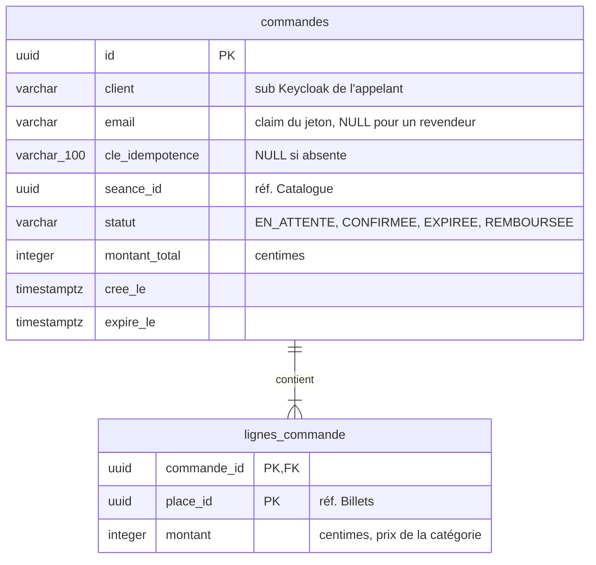
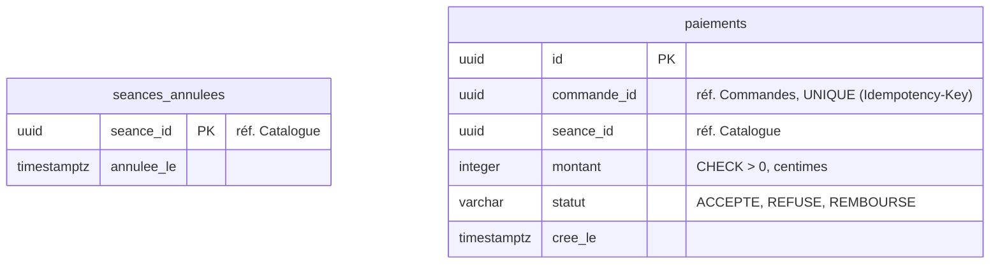
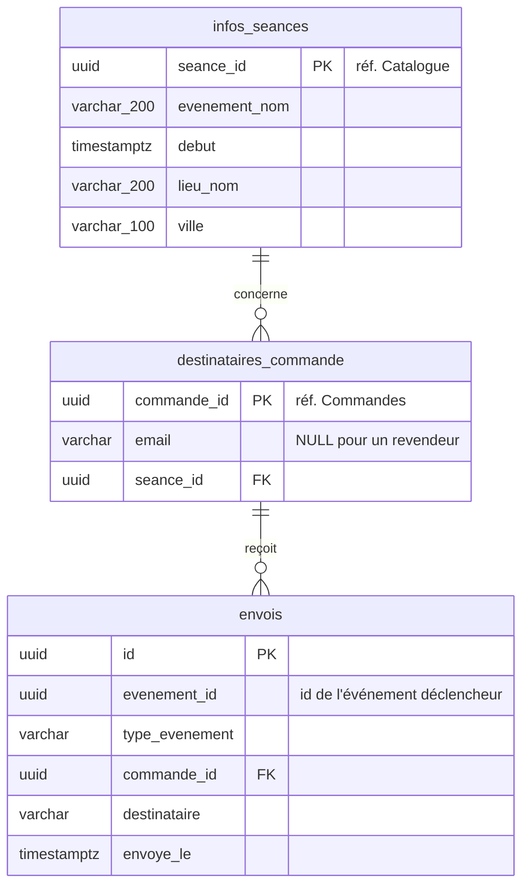

# Modèle de données

Tables de chaque service (BIL-002). Une base PostgreSQL par service, aucune table partagée, aucune
jointure entre services : un objet d'un autre service est référencé par son UUID, sans clé
étrangère (colonnes marquées « réf. »). Montants en centimes, dates `timestamptz`, énumérations
en MAJUSCULES sans accent. Les contrats d'API sont dans `docs/contrats/`, les événements dans
`docs/evenements/`.

Chaque service qui publie a la table `outbox`, chaque service qui consomme la table
`messages_traites` (`commun.outbox`) : mêmes noms, mais une copie dans chaque base.

## Catalogue

Publie `ticketing.show.scheduled` et `ticketing.show.cancelled`.

- `rangs` a pour clé `(seance_id, rang)` : un rang n'appartient qu'à une catégorie de la séance
  (`ROW_ALREADY_ASSIGNED`).
- Recherche (`q`, `ville`, `du`, `au`) : jointure locale `evenements`, `seances`, `lieux`.

## Billets

Consomme `ticketing.show.scheduled`, `ticketing.order.confirmed`, `ticketing.order.expired`,
`ticketing.show.cancelled` ; publie `ticketing.ticket.issued` et `ticketing.ticket.rejected`.

- `places` : `UNIQUE (seance_id, rang, numero)` ; lignes créées à la réception de
  `ticketing.show.scheduled` (numéros de 1 à `nombre_places` dans chaque rang).
- Contrainte `uq_billets_place` : `UNIQUE (seance_id, place_id)` sur `billets` ; la base garantit
  qu'une place n'est jamais vendue deux fois, même si le verrou Redis échoue (règle métier 2).
- Verrou d'une place : dans Redis, pas en base. Clé `place:<seance_id>:<place_id>`, valeur
  `commande_id`, `SET NX PX`. Deux durées : réservation (10 min, posée à la commande) et
  confirmation (1 h, reposée par la même commande juste avant le paiement). Prolonger ou
  confirmer un verrou détenu : script Lua qui compare la valeur puis change l'expiration, jamais
  `GET` puis `PEXPIRE`. Seul le propriétaire le libère : script Lua qui compare puis supprime, à
  la réception de `ticketing.order.expired`, une fois les billets émis ou après un rejet.
- Émission (`ticketing.order.confirmed`) : tous les billets de la commande dans une transaction
  (savepoint autour des insertions), puis suppression des verrous. Une séance présente dans
  `seances_annulees` ou un conflit sur `uq_billets_place` : retour au savepoint, aucun billet
  pour la commande, `ticketing.ticket.rejected` publié dans la même transaction (outbox), puis
  suppression des verrous de la commande. `place_ids` : places en conflit, ou toutes les places
  de la commande pour `SEANCE_ANNULEE`.
- `seances_annulees` : remplie par `ticketing.show.cancelled` (billets de la séance passés
  `ANNULE`) ; consultée à l'émission, car l'ordre des messages n'est pas garanti.
- `disponible` (contrat) : ni verrou Redis, ni billet sur la place.

## Commandes

Consomme `ticketing.show.cancelled`, `ticketing.payment.refunded` ; publie
`ticketing.order.confirmed` et `ticketing.order.expired`.

- Toute lecture filtre par `client` = appelant (règle métier 6).
- Limite de billets par séance (règle métier 3) : dans la transaction de création,
  `pg_advisory_xact_lock` sur `(client, seance_id)`, puis comptage des lignes des commandes
  `EN_ATTENTE` et `CONFIRMEE` (index `(client, seance_id)`) ; jamais de comptage sans ce verrou.
- Création : commande `EN_ATTENTE` et ses lignes d'abord (montants connus par la séance lue dans
  Catalogue), puis verrous des places ; un échec la passe `EXPIREE` et publie
  `ticketing.order.expired`. `expire_le` = fin du plus court des verrous.
- Transitions : `EN_ATTENTE` vers `CONFIRMEE` ou `EXPIREE` ; `CONFIRMEE` vers `REMBOURSEE` ;
  `EXPIREE` et `REMBOURSEE` sont finales.
- `ticketing.show.cancelled` : une commande `EN_ATTENTE` de la séance passe `EXPIREE` (et
  `ticketing.order.expired`) ; une commande `CONFIRMEE` attend `ticketing.payment.refunded`
  pour passer `REMBOURSEE`.
- `Idempotency-Key` facultatif de `POST /orders` : colonne `cle_idempotence`,
  `UNIQUE (client, cle_idempotence)`.
- La carte de test n'est jamais enregistrée.

## Paiements

Consomme `ticketing.show.cancelled` et `ticketing.ticket.rejected` ; publie
`ticketing.payment.refunded`.

- `commande_id` `UNIQUE` : un seul paiement par commande ; une requête rejouée renvoie le
  paiement enregistré.
- `seances_annulees` : remplie par `ticketing.show.cancelled`, qui rembourse les paiements
  `ACCEPTE` de la séance ; un paiement demandé pour une séance annulée répond
  `409 SHOW_CANCELLED` (l'ordre des messages n'est pas garanti).
- `ticketing.ticket.rejected` : remboursement du paiement de la commande.
- Un remboursement ne concerne qu'un paiement `ACCEPTE` (passage à `REMBOURSE` conditionnel au
  statut) : `show.cancelled` puis `ticket.rejected` sur la même commande ne publient qu'un seul
  `ticketing.payment.refunded`.
- La carte de test n'est jamais enregistrée.

## Notifications

Consomme `ticketing.show.scheduled`, `ticketing.order.confirmed`, `ticketing.ticket.issued`,
`ticketing.ticket.rejected`, `ticketing.show.cancelled`, `ticketing.payment.refunded` ; ne publie
rien.

- `infos_seances` est une projection remplie par `ticketing.show.scheduled` : intitulé, date et
  lieu des e-mails sans appeler Catalogue.
- `destinataires_commande` est une projection remplie par `ticketing.order.confirmed`, toutes
  commandes comprises : `email` NULL (revendeur) veut dire « rien à envoyer » ; une ligne
  absente veut dire « pas encore reçu » (exception, nouvel essai).
- `envois` est l'historique d'envoi ; `UNIQUE (evenement_id, commande_id)`.
