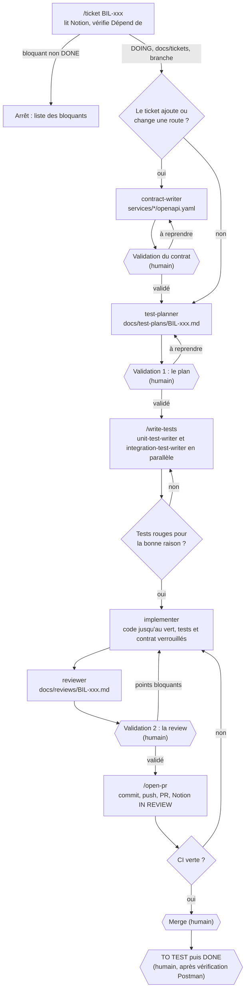

# Workflow Claude du projet

Conception de l'outillage `.claude/` (BIL-F17), écrite avant les agents, skills, rules et hooks
eux-mêmes (BIL-F18 à BIL-F25). Les sections 1 à 7 recopient la section « Workflow Claude du
projet » de la page Notion « Billetterie en ligne » ; les sections 8 à 11 complètent la
conception (pipeline, responsables, droits, marqueurs d'étape). Les écarts avec la page Notion
sont listés en section 12.

## 1. Principe

Chaque ticket suit le même pipeline. **Les agents font le travail, les skills enchaînent les
étapes et te rendent la main aux décisions, les hooks garantissent ce qui doit toujours arriver,
et le merge reste humain.** Tout cet outillage est construit dans ce projet, tickets BIL-F17 à
BIL-F25. **Le même pipeline sert au back et au front** : seuls les niveaux de tests et les outils
changent.

| Niveau de test | Back ou front | Outil | Dossier | Écrit par |
|---|---|---|---|---|
| `unitaire` | Back | pytest | `tests/unit/` | `unit-test-writer` |
| `intégration` | Back | pytest, Testcontainers | `tests/integration/` | `integration-test-writer` |
| `composant` | Front | Vitest, Testing Library, MSW | `frontend/src/**/*.test.tsx` | `unit-test-writer` |
| `parcours` | Front | Playwright | `frontend/e2e/` | `integration-test-writer` |

## 2. Outillage dans le dépôt

```txt
CLAUDE.md                  court : pile, commandes, board Notion, pipeline
.mcp.json                  serveur MCP Notion (portée projet)
.claude/
  rules/                   règles par sujet, limitées par chemin
  agents/                  contract-writer, test-planner, unit-test-writer,
                           integration-test-writer, implementer, reviewer
  skills/                  ticket, write-tests, open-pr, smoke-tests
  settings.json            déclaration des hooks
  hooks/                   scripts appelés par les hooks
```

## 3. `/ticket` lit le ticket directement dans Notion

Le serveur MCP Notion est ajouté en portée projet (`claude mcp add --transport http --scope
project notion https://mcp.notion.com/mcp`, puis `/mcp` pour s'authentifier). `CLAUDE.md`
contient l'identifiant du board. Ainsi `/ticket BIL-006` :

1. cherche dans le board la ligne dont `Ticket ID` vaut `BIL-006` ;
2. vérifie que chaque ticket de `Dépend de` est en `✅ DONE`, sinon s'arrête en listant les
   bloquants ;
3. passe le ticket en `DOING` ;
4. écrit `docs/tickets/BIL-006.md` avec seulement l'objectif, les étapes, les critères et les
   contraintes (la théorie reste dans Notion, pour économiser le contexte des agents) ;
5. crée la branche indiquée dans la propriété `Branche`, puis déroule le pipeline ;
6. `/open-pr` passe le ticket en `IN REVIEW` et ajoute le lien de la PR en commentaire.

Aucun copier-coller. Si Notion est injoignable, le skill s'arrête au lieu d'inventer le ticket.
Les statuts `TO TEST` et `DONE` restent humains.

## 4. Agents : ceux qui font le travail

| Agent | Rôle | Outils autorisés | Produit |
|---|---|---|---|
| `contract-writer` | Écrit ou modifie le contrat OpenAPI quand le ticket ajoute ou change une route : chemins, schémas, codes d'erreur métier, conformes à `docs/conventions.md` | Lecture ; écriture dans `services/*/openapi.yaml` uniquement | Contrat à valider |
| `test-planner` | Déduit les cas de test du ticket, du contrat, des critères et, pour le front, des maquettes ; étiquette chaque cas `unitaire`, `intégration`, `composant` ou `parcours` ; ajoute toujours un cas de concurrence quand Billets ou Commandes sont touchés | Lecture ; écriture dans `docs/test-plans/` uniquement | `docs/test-plans/<ticket>.md` |
| `unit-test-writer` | Tests unitaires de la logique métier et tests de composants React | Lecture ; écriture dans les dossiers de tests unitaires et `*.test.tsx` ; pas de Docker | Tests rouges |
| `integration-test-writer` | Tests d'API sur vraie base, Redis et RabbitMQ ; conformité au contrat ; concurrence avec de vraies requêtes parallèles ; parcours Playwright des écrans | Lecture ; écriture dans les dossiers de tests d'intégration et `frontend/e2e/` ; Docker (Testcontainers, `docker compose`) | Tests rouges |
| `implementer` | Code de production jusqu'au vert | Écriture dans le code de production, les migrations, `libs/`, `frontend/src/` ; tests et contrats interdits (hook) | Code, tests verts |
| `reviewer` | Relit le diff ; vérifie en priorité qu'aucune place ne peut être vendue deux fois et qu'un revendeur ne voit que ses commandes | Lecture seule et `git diff` | `docs/reviews/<ticket>.md` (bloquant, à corriger, suggestion) |

## 5. Skills : ceux qui enchaînent les étapes

| Skill | Rôle |
|---|---|
| `/ticket <ID>` | Lit le ticket dans Notion, met à jour son statut, orchestre le pipeline ; s'arrête pour ta validation après le contrat (s'il change), après le plan et après la review |
| `/write-tests` | Répartit les cas du plan selon leur niveau (`unitaire` et `composant` d'un côté, `intégration` et `parcours` de l'autre), en parallèle ; vérifie que les tests échouent pour la bonne raison |
| `/open-pr` | Commit en Conventional Commits, push, PR qui référence le ticket, le plan et la review ; ticket Notion en IN REVIEW |
| `/smoke-tests` | Hors pipeline : complète `tests/smoke/` quand une user story ajoute un parcours critique de bout en bout ; les tests Playwright d'un écran restent dans le pipeline du ticket |

## 6. Rules (`.claude/rules/`)

Une rule guide l'agent mais ne garantit rien ; ce qui doit être garanti passe par un hook.

| Fichier | Chargé pour | Contenu |
|---|---|---|
| `python.md` | `services/**/*.py`, `libs/**/*.py`, `infra/**/*.py` | Typage strict, async, client HTTP commun obligatoire, Problem Details |
| `tests.md` | `**/tests/**` | pytest, nommage, Testcontainers, pas de simulacre de la base |
| `contrats-api.md` | `**/openapi.yaml`, routes | Contrat d'abord, routes, pagination, codes d'erreur métier |
| `evenements.md` | consommateurs et publications | Nommage `ticketing.*`, enveloppe, outbox, idempotence, DLQ |
| `migrations.md` | `**/alembic/**` | Ne jamais modifier une migration appliquée ; une migration par changement |
| `securite.md` | toujours | Secrets, scopes, données de test synthétiques |
| `git.md` | toujours | Une branche par ticket, nommage, Conventional Commits |
| `frontend.md` | `frontend/**` | Conventions React, client d'API généré, jeton en mémoire |
| `places-concurrence.md` | `services/billets/**`, `services/commandes/**` | Verrou Redis `SET NX` avec expiration, contrainte unique en base toujours présente, jamais de lecture puis écriture sans verrou |
| `billets-qr.md` | `services/billets/**` | QR code signé, aucun billet émis avant `ticketing.order.confirmed` |

## 7. Hooks (`.claude/settings.json`)

| Événement | Hook | Effet |
|---|---|---|
| Après édition d'un `.py` | ruff format et ruff check | Code toujours formaté, erreurs signalées à l'agent |
| Après édition d'un `.ts` ou `.tsx` | Prettier et ESLint | Même garantie pour le front |
| Avant écriture | Protection des fichiers | Bloque `.env`, secrets, et toute écriture sur `main` |
| Avant écriture dans un dossier de tests, un `*.test.tsx` ou `frontend/e2e/` | Tests protégés | Bloqué pendant l'implémentation (marqueur posé par `/ticket`) |
| Avant écriture dans un `openapi.yaml` | Contrat protégé | Bloqué hors de l'étape contrat (marqueur posé par `/ticket`) |
| Avant une commande Bash | Git sûr | Bloque `git push --force`, merge sur `main`, `gh pr merge`, sans exception |
| Fin de tour | Tests rapides | Lance pytest unitaire si du Python a changé, Vitest si le front a changé ; signale un échec |
| Commit | Hook Git `commit-msg` | Refuse un message hors Conventional Commits (déjà en place, `.githooks/`) |

## 8. Pipeline d'un ticket



## 9. Un responsable unique par étape

| # | Étape | Responsable unique | Entrée | Sortie | Marqueur `.claude/etape` |
|---|---|---|---|---|---|
| 1 | Lire le ticket, vérifier les dépendances, passer en DOING, écrire `docs/tickets/`, créer la branche | skill `/ticket` | Board Notion | `docs/tickets/BIL-xxx.md`, branche | `cadrage` |
| 2 | Écrire ou modifier le contrat (si une route change) | agent `contract-writer` | Ticket, `docs/conventions.md`, contrat existant | `services/*/openapi.yaml` | `contrat` |
| 3 | **Validation du contrat** (si l'étape 2 a eu lieu) | **humain** | Diff du contrat | Accord ou reprise | `contrat` |
| 4 | Écrire le plan de test | agent `test-planner` | Ticket, contrat, critères, maquettes | `docs/test-plans/BIL-xxx.md` | `plan` |
| 5 | **Validation 1 : le plan** | **humain** | Plan | Accord ou reprise | `plan` |
| 6 | Répartir et faire écrire les tests, vérifier qu'ils échouent pour la bonne raison | skill `/write-tests` | Plan validé | Tests rouges | `tests` |
| 6a | Tests unitaires et de composants | agent `unit-test-writer` | Cas `unitaire`, `composant` | Tests rouges | `tests` |
| 6b | Tests d'intégration et parcours | agent `integration-test-writer` | Cas `intégration`, `parcours` | Tests rouges | `tests` |
| 7 | Coder jusqu'au vert | agent `implementer` | Tests rouges, contrat | Code, tests verts | `implementation` |
| 8 | Relire le diff | agent `reviewer` | `git diff`, plan, ticket | `docs/reviews/BIL-xxx.md` | `review` |
| 9 | **Validation 2 : la review** | **humain** | Rapport de review | Accord, ou points bloquants renvoyés à l'étape 7 | `review` |
| 10 | Commit, push, PR, Notion IN REVIEW | skill `/open-pr` | Branche validée | PR ouverte | `pr` |
| 11 | Faire passer la CI | GitHub Actions | PR | Jobs verts (sinon retour à l'étape 7) | `pr` |
| 12 | **Merge** | **humain** | PR, CI verte | `main` à jour | aucun (retiré par `/open-pr` après la PR) |
| 13 | **TO TEST puis DONE** | **humain** | Plateforme, Postman | Ticket clos | aucun |

Les étapes 6a et 6b tournent en parallèle sous la responsabilité de `/write-tests`, chacune avec
son propre agent : chaque niveau de test a un seul auteur. `/ticket` orchestre les étapes 2 à 9
mais n'en exécute aucune lui-même : il lance l'agent responsable et pose le marqueur.

**Points de décision humaine** : la validation du contrat (seulement si une route change), la
validation 1 (plan), la validation 2 (review), le merge et la clôture du ticket. Aucun agent ne
merge : le hook « Git sûr » bloque `gh pr merge` sans exception.

## 10. Droits : qui lit, écrit où, lance quoi

Chemins des tests dans ce dépôt : `tests/unit/` et `tests/integration/` à la racine (code commun,
infrastructure), et `services/<nom>/tests/{unit,integration,contract}/`, `infra/<nom>/tests/`
pour chaque composant.

| Acteur | Lit | Écrit | Lance | Interdit (garanti par hook) |
|---|---|---|---|---|
| `/ticket` | Notion (MCP), dépôt | `docs/tickets/`, `.claude/etape`, statut Notion (DOING) | `git switch -c`, les agents | Écrire sur `main` |
| `contract-writer` | Ticket, `docs/conventions.md`, contrats | `services/*/openapi.yaml` | Rien | Tout autre chemin ; écrire hors étape `contrat` |
| `test-planner` | Ticket, contrats, code, maquettes | `docs/test-plans/` | Rien | Tout autre chemin |
| `/write-tests` | Plan | Rien lui-même | `unit-test-writer`, `integration-test-writer`, `make test-unit`, `make test-integration` | — |
| `unit-test-writer` | Plan, contrat, code | `tests/unit/`, `services/*/tests/unit/`, `infra/*/tests/unit/`, `frontend/src/**/*.test.tsx` | `make test-unit`, Vitest | Docker ; code de production |
| `integration-test-writer` | Plan, contrat, code | `tests/integration/`, `services/*/tests/{integration,contract}/`, `frontend/e2e/` | `make test-integration`, `docker compose`, Playwright | Code de production |
| `implementer` | Tout le dépôt | `services/*/src/`, `services/*/alembic/`, `libs/`, `infra/`, `frontend/src/` (hors `*.test.tsx`), `compose.yaml` | `make test`, `make lint`, `make typecheck`, `docker compose` | Tests et contrats (étape `implementation`) ; `.env` |
| `reviewer` | Tout le dépôt, `git diff` | `docs/reviews/` | `git diff`, `git log` | Toute autre écriture |
| `/open-pr` | Branche, plan, review | Commit, `.claude/etape` (retrait), statut Notion (IN REVIEW), commentaire | `git commit`, `git push`, `gh pr create` | `git push --force`, `gh pr merge` |
| Hooks | Fichier édité, commande, marqueur | Rien (sauf ruff et Prettier sur le fichier édité) | ruff, Prettier, ESLint, pytest, Vitest | — |
| Humain | Tout | Tout | Validations, merge, TO TEST, DONE | — |

## 11. Marqueurs d'étape (`.claude/etape`)

Fichier d'une ligne, posé et mis à jour par `/ticket`, retiré par `/open-pr` une fois la PR
ouverte. Il est local au poste (ignoré par Git) : il décrit l'état de la session, pas du dépôt.
Absent, aucune restriction liée au pipeline ne s'applique (travail hors pipeline, comme les
tickets BIL-F01 à BIL-F24).

| Valeur | Étape | Hooks qui le lisent | Effet |
|---|---|---|---|
| `cadrage` | Lecture du ticket, branche | — | Aucun blocage propre |
| `contrat` | Écriture et validation du contrat | Contrat protégé | `openapi.yaml` modifiable ; seule étape où il l'est |
| `plan` | Plan de test et validation 1 | Contrat protégé | Contrat verrouillé |
| `tests` | Écriture des tests | Contrat protégé | Contrat verrouillé ; tests modifiables |
| `implementation` | Code jusqu'au vert | Tests protégés, contrat protégé | Tests et contrat verrouillés |
| `review` | Review et validation 2 | Tests protégés, contrat protégé | Tests et contrat verrouillés ; un point bloquant renvoie à `implementation` |
| `pr` | Ouverture de la PR, CI | Tests protégés, contrat protégé | Idem ; un échec de CI renvoie à `implementation` |

Hooks indépendants du marqueur, toujours actifs : formatage (ruff, Prettier), protection de
`.env` et des secrets, interdiction d'écrire sur `main`, « Git sûr », tests rapides en fin de
tour, `commit-msg`.

Changer de marqueur est un acte de `/ticket` seul, après la décision humaine qui le justifie
(par exemple `plan` vers `tests` après la validation 1) : un agent ne lève jamais lui-même le
verrou qui le concerne.

## 12. Écarts avec la page Notion

- **Agent `contract-writer`** (décision du développeur, BIL-F17) : ajouté avant `test-planner`,
  avec sa propre validation humaine, uniquement quand le ticket ajoute ou change une route. La
  page Notion ne disait pas qui écrit le contrat. Hook « Contrat protégé » ajouté en
  conséquence. Aucun ticket du board ne crée encore cet agent.
- **Merge** : le hook « Git sûr » bloque `gh pr merge` sans exception (décision du développeur) ;
  le développeur merge lui-même.
- **Chemins des tests** : la page cite `tests/unit/` et `tests/integration/` ; ce dépôt a aussi
  des tests par composant (`services/*/tests/`, `infra/*/tests/`). Les droits de la section 10
  couvrent les deux.
- **Rule `python.md`** : chargée aussi pour `infra/**/*.py` (le vérificateur de jetons est du
  Python dans `infra/`).
